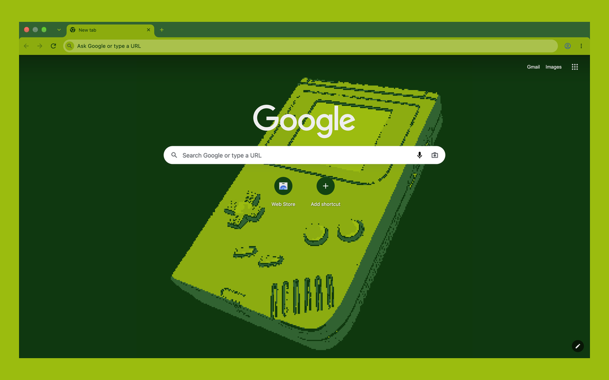

# DMG Mode Theme

A Chrome and Firefox theme in the DMG Mode pea-green palette (`#0f380f` `#306230` `#8bac0f` `#9bbc0f`). Companion to the [DMG Mode extension](https://github.com/Zapskii/dmg-mode).



| Part | Shade |
|---|---|
| Window frame, background tabs | `#306230` (`#0f380f` when unfocused or incognito) |
| Active tab, toolbar | `#8bac0f` |
| Address bar | `#9bbc0f` |
| New Tab page | `#0f380f`; Chrome adds a pixelated Game Boy in the centre (`theme/images/ntp-background.png`) |
| Tab strip, top right (Firefox) | a small pixelated Game Boy (`theme/images/frame-corner.png`) |
| Text and icons | `#0f380f` |

Firefox themes can't put an image on the New Tab page, so the Firefox version shows its Game Boy in the corner of the tab strip instead.

## Install (development)

**Chrome:** `chrome://extensions` → turn on **Developer mode** → **Load unpacked** → pick `theme/`. To go back: `chrome://settings/appearance` → **Reset to default**.

**Firefox:** run `./build.sh`, then `about:debugging#/runtime/this-firefox` → **Load Temporary Add-on…** → pick `dist/dmg-mode-theme-firefox-<version>.zip`. It lasts until Firefox restarts.

## Build

`./build.sh` makes two packages in `dist/`:

- `dmg-mode-theme-<version>.zip` for the Chrome Web Store
- `dmg-mode-theme-firefox-<version>.zip` for addons.mozilla.org. Its manifest is `theme/manifest.json` with `manifest.firefox.json` laid over it (`tools/firefox-manifest.js`). The overlay replaces the whole `theme` block, because Firefox uses different colour names, and adds the add-on ID.

Each zip leaves out the other browser's image. Check the Firefox one with `npx addons-linter dist/dmg-mode-theme-firefox-<version>.zip`.

## Images

`tools/dmgify.py` snaps a render to the 4 shades: background and outlines darkest, then shadows, body and highlights. The source render is `art/gameboy-render.png`.

```
python3 tools/dmgify.py art/gameboy-render.png theme/images/ntp-background.png 3
python3 tools/dmgify.py art/gameboy-render.png theme/images/frame-corner.png 4 --frame 44
```

## Credits

The source render (`art/gameboy-render.png`) and the images made from it (`theme/images/ntp-background.png`, `theme/images/frame-corner.png`, and the console in `store/`) come from [Nintendo Game Boy 1989 - High Poly Model](https://sketchfab.com/3d-models/nintendo-game-boy-1989-high-poly-model-300c418fb222409abe354926eaa208b2) by [lion.gelders](https://sketchfab.com/lion.gelders), licensed under [CC BY 4.0](https://creativecommons.org/licenses/by/4.0/). Changes: rendered to a still image, then pixelated and reduced to the 4-shade DMG palette with `tools/dmgify.py`.
